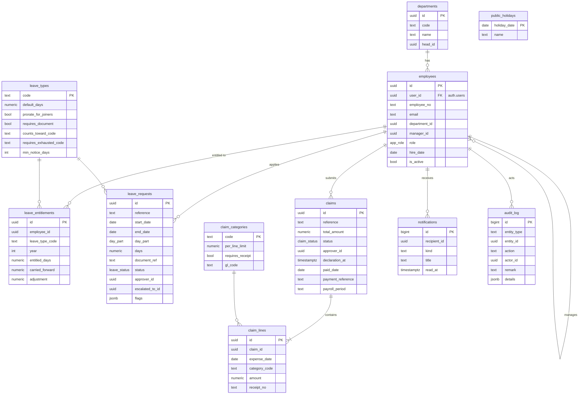

# Workday Clone — Leave & Claims Portal

A Workday-style self-service portal for **leave applications and expense claims**. It uses Next.js (App Router) on Vercel and a Supabase backend (Postgres, Auth, Storage, pg_cron).

It implements the workflows in the AIA activity sheets (Activities 1.1–1.2):

| Activity sheet requirement | Where it lives |
|---|---|
| One online form that checks the employee's **balance** and **team clashes** | `Time Off › Request` — live preview calls `preview_leave()` |
| Working days exclude **weekends and MOM public holidays** | `working_days()` + `public_holidays` (2026–2027 seeded) |
| **Auto-routing** to the supervisor / Department Head; a **Head's own leave goes to the Director**; nobody approves their own request | `route_approver()` |
| **Reminder after 1 working day, escalation after 2** | `process_approval_reminders()` scheduled hourly (Mon–Fri) with pg_cron |
| One-click **approve / reject**, and a reject needs a remark | `Inbox` → `decide_leave_request()` / `decide_claim()` |
| On approval the **tracker and balance update by themselves**, with zero re-keying | Balances are computed from approved leave (`leave_balances` view = Master Leave Record) |
| **Employee, Office Manager and HR are notified** | `notifications` table, bell icon, notification centre |
| **Pro-rating for joiners** (e.g. a July 2026 joiner gets 7 of 14 days AL) | `prorated_entitlement()` |
| **Sick leave counts toward the hospitalisation cap** | `leave_types.counts_toward_code` |
| **No-pay leave only after annual leave is used up** | `leave_types.requires_exhausted_code` |
| Short notice and over-limit are **flags, not blocks** | `flags` JSON on each request / claim, shown to the approver |
| Reference numbers `LV-2026-0001` / `CL-2026-0001` | `next_reference()` |
| Claims: lines, **receipt numbers**, **declaration**, Head approves, then **Finance pays** (date + reference) or **returns** | `submit_claim()`, `decide_claim()`, `pay_claim()`, `return_claim()`, `resubmit_claim()` |
| **CSV export** for payroll (HR leave, Finance claims) | `/api/export/leave`, `/api/export/balances`, `/api/export/claims` |
| **Time-stamped audit trail** for every request | `audit_log`, shown on every request page |
| **Live view for HR**, plus a **monthly report** with KPIs and unusual patterns | `HR › Leave Tracker`, `HR › Monthly Report` (`hr_monthly_report()`) |
| "Anyone can pick a name": **link sign-ins before go-live** | Supabase Auth. Sign-up is only accepted for emails HR registered, and the account is linked to the worker record automatically |
| Works on mobile | Responsive layout |

### The "break it 10 ways" test, enforced in the database

Each of these is blocked with a clear message and nothing is saved:

1. Overlapping leave: *You already have leave on these dates (LV-2026-0005).*
2. Over balance: *Not enough Annual Leave: 9 day(s) requested but only 6.0 available for 2026.*
3. Across years: *Leave cannot run across two calendar years…*
4. Sick leave without an MC: *MC number is required for Sick Leave (Outpatient).*
5. Unpaid before annual: *Use your remaining Annual Leave (6.0 day(s)) before applying for No-pay Leave.*
6. Holiday-only day: *The selected dates fall only on weekends or public holidays…*
7. No receipt: *Line 1: receipt number is required for Local transport…*
8. No declaration: *Tick the declaration to confirm…*
9. Reject without a remark: *Add a remark explaining why the request is rejected.*
10. Pay without a reference: *Payment reference is required to mark a claim as paid.*

Also blocked: self-approval, deciding a request you are not assigned to, and re-using a receipt number from an earlier claim.

---

## Architecture

```
Browser ──► Next.js 16 on Vercel (Server Components + Server Actions, proxy.ts refreshes the session)
                │  publishable key + the user's JWT
                ▼
           Supabase
             ├─ Auth (email + password)
             ├─ Postgres: tables + RLS + SECURITY DEFINER RPCs (all business rules)
             ├─ Storage: private "attachments" bucket (MCs, receipts) with signed URLs
             └─ pg_cron: hourly reminders / escalation
```

All workflow writes go through Postgres functions. Clients cannot insert or update `leave_requests`, `claims`, `claim_lines`, `audit_log` or `notifications` directly. Row Level Security decides who can read what:

| Role | Sees |
|---|---|
| Employee | Own requests, claims, balances; team calendar (no reasons or MC numbers) |
| Manager / Department Head | The above, plus requests assigned to them and their reporting line's leave and balances |
| Director | All leave and claims; approves Department Heads |
| HR | All leave, the Master Leave Record, entitlements, workers, policies, holidays and reports |
| Office Manager | Live leave tracker and reports (read-only), notified on every approval |
| Finance | All claims, the payment queue, pay/return, claim CSV and claim-category limits |

## Database schema



The view `leave_balances` (Master Leave Record) holds entitlement + carried forward + adjustment − approved − pending − linked usage. It is computed live, so it always matches approved leave.

Migrations are in [`supabase/migrations`](supabase/migrations) and demo data is in [`supabase/seed.sql`](supabase/seed.sql).

---

## Run locally

```bash
cp .env.example .env.local     # already points at the live Supabase project
npm install
npm run dev                    # http://localhost:3000
```

## Deploy to Vercel

1. In Vercel, choose **Add New › Project**, import `MichNg13/workday-clone`, and keep the Next.js defaults.
2. Environment variables are optional. The app falls back to the project's publishable URL and key. To point at another project, set `NEXT_PUBLIC_SUPABASE_URL` and `NEXT_PUBLIC_SUPABASE_PUBLISHABLE_KEY`.
3. Deploy.
4. In Supabase, go to **Authentication › URL Configuration** and set **Site URL** to your Vercel URL. Add `https://<your-app>.vercel.app/**` to the redirect URLs so sign-up and password-reset emails link back to the app.
5. Optional: set `NEXT_PUBLIC_SHOW_DEMO_ACCOUNTS=false` to hide the demo-account panel on the sign-in page.

## Set up a fresh Supabase project

Apply the files in `supabase/migrations` in order: `supabase db push`, or paste them into the SQL editor. Then run `supabase/seed.sql` if you want demo data.

## Demo accounts

Every demo account uses the password **`Workday#Demo2026`**. Delete these users before real use.

| Email | Who | Try |
|---|---|---|
| daniel.lim@example.com | Operations Executive | Request leave, submit a claim |
| priya.nair@example.com | Sales Executive, joined Jul 2026 | Pro-rated AL (3 of 7 left) |
| meiling.wong@example.com | Head of Operations | Inbox: approve Daniel / Ahmad (clash flag) |
| rajesh.kumar@example.com | Head of Sales | Approve Priya's SGD 140.30 claim |
| grace.tan@example.com | Managing Director | Approves Department Heads; receives escalations |
| sarah.chen@example.com | HR Manager | Master Leave Record, entitlements, workers, report |
| nurul.huda@example.com | Office Manager | Live tracker, approval notifications |
| kevin.ong@example.com | Finance Manager | Payment queue: pay with reference or return |

## Next steps before go-live

- Replace the default entitlements and claim limits with the contract and finance policy figures (HR › Policies & Holidays).
- Delete the demo users. Add real workers (People › Add worker) and have them sign up with their work email.
- Turn on Supabase **leaked-password protection**, and add custom SMTP for auth emails.
- Optional: send email or Teams notifications from the `notifications` table, using a Supabase Edge Function or Database Webhook.
